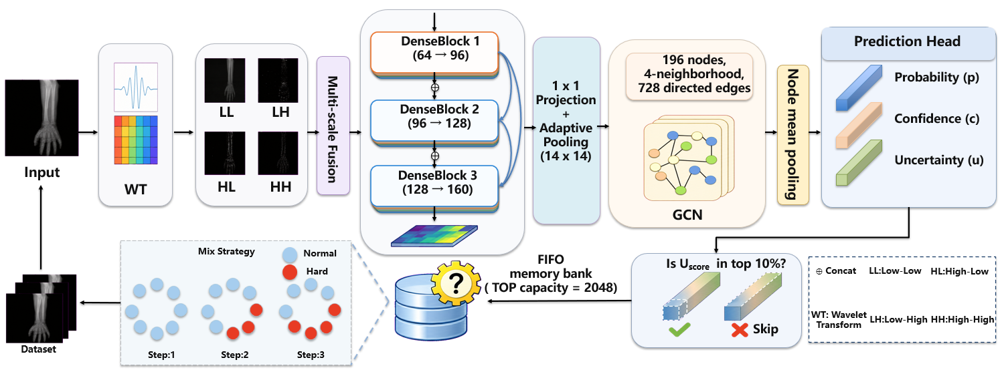

# WUD-Net

**WUD-Net: A Wavelet-Uncertainty Dual-Driven Network for Musculoskeletal Image Classification**

Wenchao Zhang, Xianwen Yan, Ran Chen, Longfei Li, Lei Yao, Zhe Liu, Dapeng Li, and Hua Xie

PyTorch implementation accompanying the WUD-Net manuscript. We combine multiscale wavelet representation, spatial graph convolution, and uncertainty-guided sample replay for image-level fracture classification.

## Overview



- **W-AMF** fuses two-level wavelet subbands before dense feature extraction to capture structural and frequency information across scales.
- **Spatial GCN** aggregates four-neighbor relationships on a 14 × 14 feature grid for image-level prediction.
- **MU-OHEM** combines learned predictive ambiguity and confidence scores with a FIFO memory bank and staged hard-example replay.

## Main results

**Five-fold results reported in the manuscript** (mean ± standard deviation):

| Dataset | Precision | Recall | F1 | AUC |
|---|---:|---:|---:|---:|
| MURA fracture subset | 0.944 ± 0.003 | 0.933 ± 0.007 | 0.939 ± 0.004 | 0.898 ± 0.004 |
| FracAtlas | 0.960 ± 0.004 | 0.881 ± 0.009 | 0.920 ± 0.006 | 0.926 ± 0.005 |
| HBFMID | 0.964 ± 0.004 | 0.863 ± 0.011 | 0.911 ± 0.007 | 0.919 ± 0.005 |

The table summarizes development-set cross-validation; independent-test performance is evaluated separately.

## Datasets

| Dataset | Images used | Development | Independent test |
|---|---:|---:|---:|
| [MURA fracture subset](https://stanfordmlgroup.github.io/competitions/mura/) | 1,312 | 1,115 | 197 |
| [FracAtlas](https://doi.org/10.6084/m9.figshare.22363012) | 4,083 | 3,470 | 613 |
| [HBFMID](https://data.mendeley.com/datasets/xwfs6xbk47/1) | 1,536 | 1,382 | 154 |

The MURA subset contains 656 fracture-annotated images from [MURA-Objects](https://github.com/wangxin1216/MURA-Objects) and 656 non-fracture controls manually screened by the first author, a physician. Its test set contains 81 fracture and 116 non-fracture images. This subset uses fracture labels rather than the original normal/abnormal labels. HBFMID includes radiographs, MRI, and augmented images; three empty-label images are excluded from the public 1,539-image release.

Use image-level labels `1 = fracture`, `0 = non-fracture`. Prepare a CSV with `image_path,label,split,fold,group_id`: development images use folds 0–4, test images use fold -1, and patient/source-image groups remain within one fold or the test set. `prepare_folds.py` can assign development folds while preserving a supplied test split.

Images, experiment-specific split manifests, and trained weights are obtained separately. The original experiment splits and corresponding checkpoints are required to reproduce the reported runs.

## Quick start

Checked with Python 3.8.19, PyTorch 2.4.1+cu118, and torchvision 0.19.1. From the repository root, after preparing `manifests/mura.csv`:

```bash
python -m pip install -r requirements.txt
python train.py --manifest manifests/mura.csv --dataset mura --output runs/mura_full --device cuda:0
python evaluate.py --manifest manifests/mura.csv --dataset mura --run runs/mura_full --output runs/mura_test --mode vote --device cuda:0
```

Training defaults: 384 × 384 images, 100 epochs, batch size 32, AdamW, and a classification threshold of 0.5. Five development folds run by default; validation AUC selects each checkpoint. MURA test evaluation uses five-model majority voting, with average probabilities used for AUC.

For the other datasets, select `--dataset fracatlas` or `--dataset hbfmid` with the corresponding manifest. Single-model testing uses `--mode single --fold 0`, with the fold fixed before test evaluation. Outputs include fold metrics, per-image predictions, and test confusion matrices. Experiment options are listed by `python train.py --help`.

## Citation and contact

If you use this work, please cite the manuscript:

```bibtex
@unpublished{zhang2026wudnet,
  title  = {WUD-Net: A Wavelet-Uncertainty Dual-Driven Network for Musculoskeletal Image Classification},
  author = {Zhang, Wenchao and Yan, Xianwen and Chen, Ran and Li, Longfei and Yao, Lei and Liu, Zhe and Li, Dapeng and Xie, Hua},
  year   = {2026},
  note   = {Manuscript}
}
```

**Corresponding authors:** Dapeng Li ([lidapeng706@163.com](mailto:lidapeng706@163.com)) and Hua Xie ([Sparc2132@163.com](mailto:Sparc2132@163.com)).
